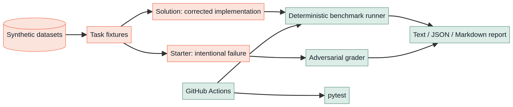

# ML Leakage & Validation Benchmark

A deterministic, adversarial benchmark for evaluating model-generated machine-learning code. It targets three failure classes that routinely survive superficial review: data leakage, invalid validation for temporal data, and unstable or irreproducible training.

The repository contains intentionally flawed starters, corrected reference solutions, source-aware graders, a deterministic report runner, pinned dependencies, and GitHub Actions CI. It uses only synthetic data and makes no network calls.

## Why this benchmark exists

A model-generated ML patch can look plausible while still leaking held-out information, shuffling a time series, or producing a different result on every run. LearnFlow-style application tests are not enough for this class of defect: the benchmark combines behavioral checks with structural checks that inspect the implementation pattern itself.

## Benchmark tasks

| Task | Failure being tested | Incorrect pattern | Correct pattern |
| --- | --- | --- | --- |
| Task 1 — Leakage | Test information enters preprocessing | Fit a scaler before the train/test split | Put preprocessing and estimator in a `Pipeline` and fit only on training data |
| Task 2 — Validation | Temporal order is destroyed | Random `train_test_split(..., shuffle=True)` | `TimeSeriesSplit` with chronological folds |
| Task 3 — Unstable training | Numerical instability and nondeterminism | Unscaled features, high learning rate, unseeded RNG | Scaled pipeline, conservative estimator, explicit seed |

Each task has three files:

- `starter.py`: a deliberately wrong implementation used to verify that the grader detects the failure pattern.
- `solution.py`: a corrected implementation that must pass behavioral and structural checks.
- `test_grader.py`: the task-specific adversarial grader.

## Architecture



The benchmark separates fixtures from verification. Starters preserve the failure modes, solutions demonstrate safe patterns, graders inspect both source and runtime behavior, and the runner creates a machine-readable report for CI or review workflows.

```text
Synthetic data -> starter / solution fixtures
                         |             |
                   source grader   runtime runner
                         \             /
                         Text / JSON / Markdown report
```

The source diagram is available as [`docs/architecture.mmd`](docs/architecture.mmd).

## Requirements

- Python 3.11 or newer.
- `pip` or a compatible environment manager.
- No database, API key, GPU, or network access is required.

The exact runtime dependencies are pinned in [`requirements.txt`](requirements.txt).

## Installation

### Local virtual environment

```bash
python3.11 -m venv .venv
source .venv/bin/activate
python -m pip install --upgrade pip
python -m pip install -r requirements.txt
```

### Docker

```bash
docker build -t ml-validation-integrity-suite .
docker run --rm ml-validation-integrity-suite
```

The image runs the complete pytest suite. For an interactive report inside the image:

```bash
docker run --rm ml-validation-integrity-suite python -m benchmark --format markdown
```

## Run the benchmark

Run the full adversarial suite:

```bash
pytest -q
```

Run the deterministic reference runner:

```bash
python -m benchmark
```

Example output:

```text
PASS  Leakage-safe preprocessing: 0.9500 (repeat 0.9500)
PASS  Time-aware validation: 0.9920 (repeat 0.9920)
PASS  Stable and reproducible training: 1.0000 (repeat 1.0000)

Summary: 3/3 passed.
```

Generate a Markdown report for a pull request or release artifact:

```bash
python -m benchmark --format markdown --output reports/benchmark.md
```

Generate JSON for dashboards or downstream evaluators:

```bash
python -m benchmark --format json --output reports/benchmark.json
```

The runner fails with a non-zero exit status if a solution is nondeterministic, returns a non-finite score, or violates the structural markers for its task.

## Evaluation rubric

The reference rubric is in [`evaluation/rubric.md`](evaluation/rubric.md):

- **Leakage — 40%:** no test information is used during training; preprocessing is fit only on training data.
- **Validation — 30%:** the split strategy matches the data type; time series use chronological folds.
- **Reproducibility — 20%:** randomness is seeded and locked dependencies produce repeatable results.
- **Performance — 10%:** the score is acceptable, finite, and free of crashes.

A solution is considered passing only when all four categories are satisfied. The included graders additionally confirm that each starter still contains the intended failure pattern, preventing accidental weakening of the benchmark.

## Configuration

The benchmark intentionally has no runtime secrets or external service configuration. Reproducibility is controlled by:

- Python version: 3.11 in CI.
- Exact versions in `requirements.txt`.
- Explicit seeds in the corrected solutions.
- Synthetic datasets generated inside each task.
- No network calls or environment-dependent fixtures.

To add a task, create a new directory under `tasks/`, add `starter.py`, `solution.py`, and `test_grader.py`, then register the solution in `benchmark/runner.py` with required and forbidden source markers.

## CI

GitHub Actions runs on every push and pull request:

1. Installs Python 3.11 and the pinned requirements.
2. Runs `pytest -q`.
3. Generates a Markdown benchmark report.
4. Uploads the report as a workflow artifact.

Workflow definition: [`.github/workflows/ci.yml`](.github/workflows/ci.yml).

## Troubleshooting

### `ModuleNotFoundError: sklearn`

Activate the virtual environment and install the lockstep requirements:

```bash
source .venv/bin/activate
python -m pip install -r requirements.txt
```

### Tests pass locally but fail in CI

Use Python 3.11 and the pinned requirements. Avoid upgrading NumPy or scikit-learn independently; version changes can alter solver behavior and score tolerances.

### The report says a task is nondeterministic

Run the task twice directly and inspect random-state handling. The corrected pattern should seed both dataset generation and estimators where applicable. Do not use `RandomState(None)`, global unseeded randomness, or time-dependent data.

### A structural check fails

Read the task's `test_grader.py` and compare the source markers with the intended pattern. The benchmark is deliberately source-aware: a behaviorally plausible workaround may still fail if it hides a leakage-prone implementation.

### Docker build is stale

Rebuild without relying on a cached dependency layer:

```bash
docker build --no-cache -t ml-validation-integrity-suite .
```

### Generated files appear in Git

Python caches and generated report files are ignored by `.gitignore`. Clean an already tracked cache with:

```bash
git rm -r --cached tasks/**/__pycache__ 2>/dev/null || true
```

## Project layout

```text
benchmark/              Deterministic runner and report formatters
evaluation/             Human-readable rubric
tasks/task1_leakage/    Leakage fixture, solution, and grader
tasks/task2_validation/ Temporal-validation fixture, solution, and grader
tasks/task3_unstable_training/ Stability fixture, solution, and grader
docs/                   Architecture source and rendered diagram
.github/workflows/      Reproducible CI
Dockerfile              Test-oriented container image
requirements.txt        Pinned Python dependencies
```

## Screenshots and visual evidence

This is a command-line benchmark rather than a web application, so the most useful visual evidence is the architecture diagram and the generated Markdown report. CI publishes that report as an artifact; locally, open `reports/benchmark.md` after running the Markdown command.

## License

MIT
